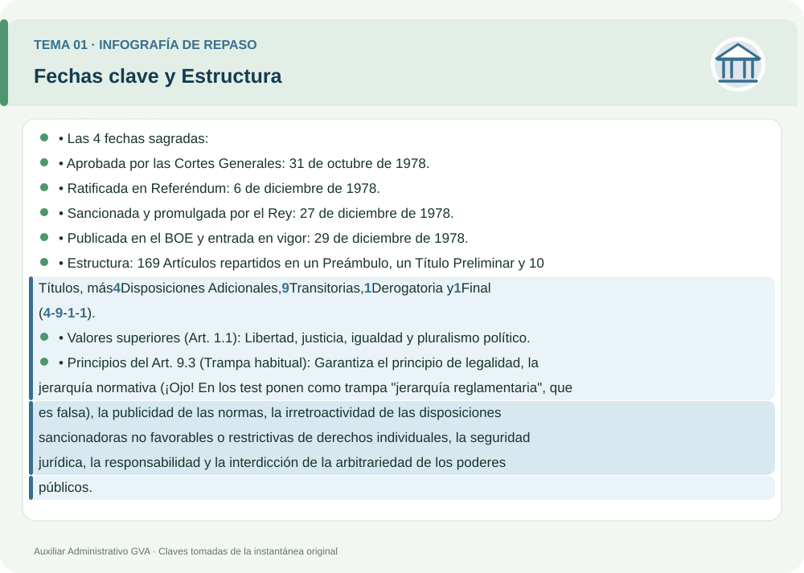
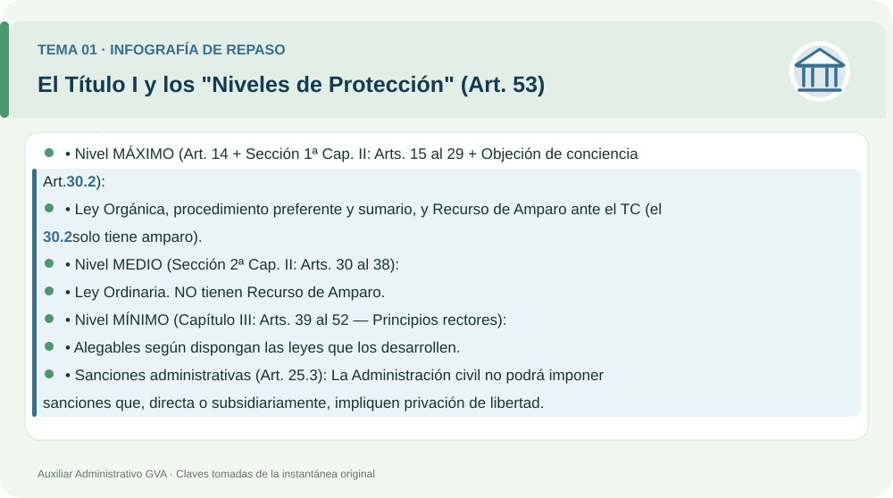
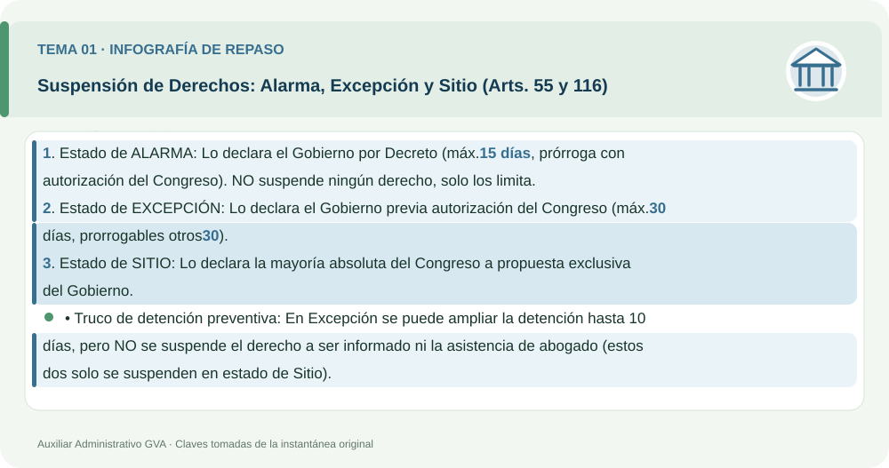

# Tema 01. Constitución Española: Título Preliminar, derechos y organización territorial

> Infografías elaboradas a partir de las instantáneas del documento de estudio. Cada ficha mantiene separadas las normas que aparecen en su contenido.

## Constitución Española de 1978

### Instantánea 1: Fechas clave y Estructura

### Instantánea 2: El Título I y los "Niveles de Protección" (Art. 53)

### Instantánea 3: Suspensión de Derechos: Alarma, Excepción y Sitio (Arts. 55 y 116)

