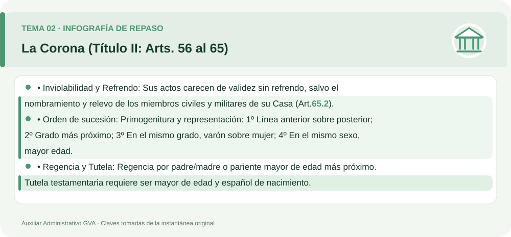
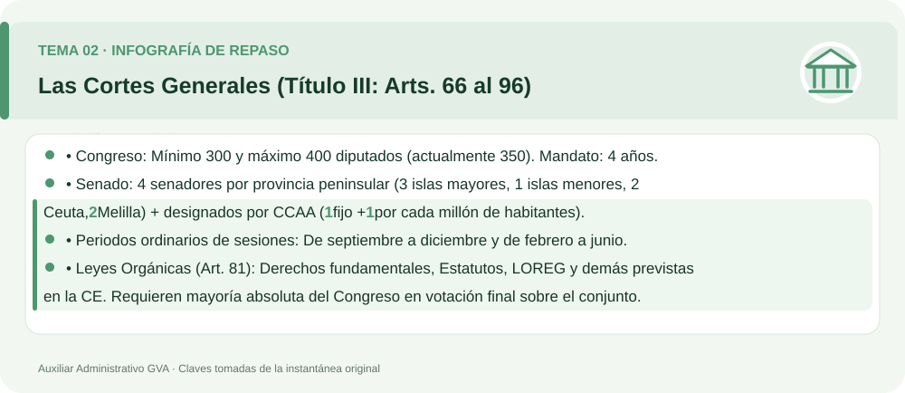

# Tema 02. Constitución Española: Corona y Cortes Generales

> Infografías elaboradas a partir de las instantáneas del documento de estudio. Cada ficha mantiene separadas las normas que aparecen en su contenido.

## Constitución Española de 1978

### Instantánea 4: La Corona (Título II: Arts. 56 al 65)

### Instantánea 5: Las Cortes Generales (Título III: Arts. 66 al 96)

