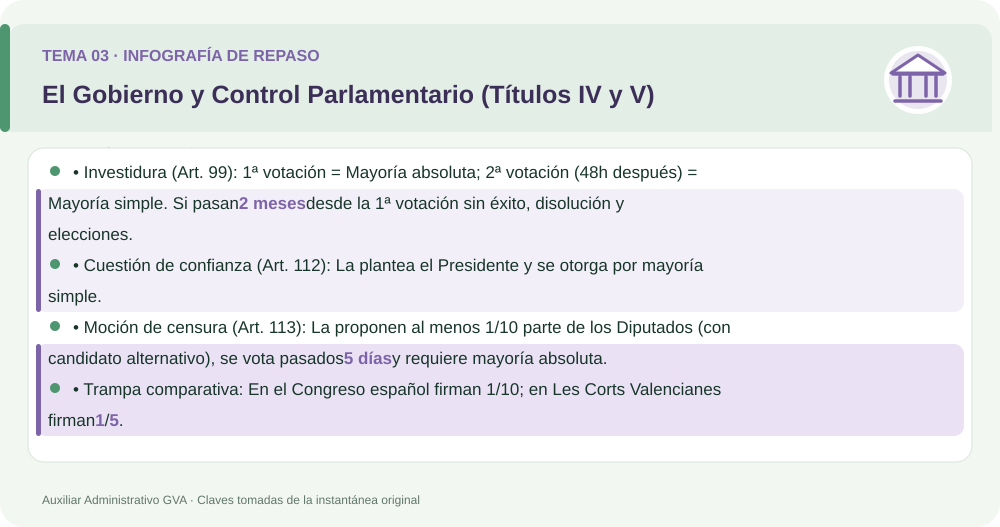
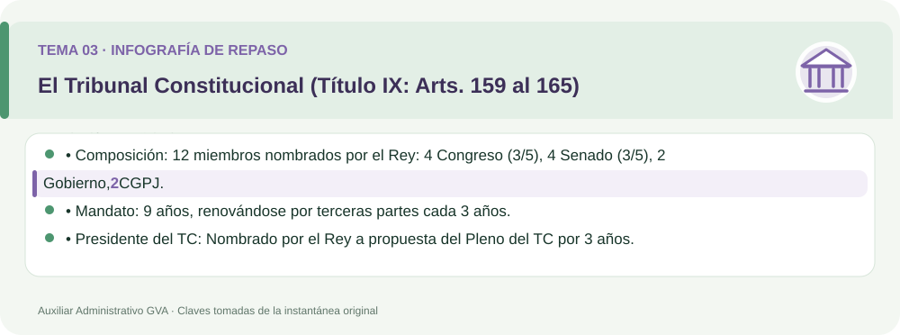

# Tema 03. Constitución Española: Gobierno, Administración y Poder Judicial

> Infografías elaboradas a partir de las instantáneas del documento de estudio. Cada ficha mantiene separadas las normas que aparecen en su contenido.

## Constitución Española de 1978

### Instantánea 6: El Gobierno y Control Parlamentario (Títulos IV y V)

### Instantánea 7: El Tribunal Constitucional (Título IX: Arts. 159 al 165)

