# Tema 04. Estatuto de Autonomía de la Comunitat Valenciana

> Infografías elaboradas a partir de las instantáneas del documento de estudio. Cada ficha mantiene separadas las normas que aparecen en su contenido.

## Estatuto de Autonomía de la Comunitat Valenciana (LO 5/1982)

### Instantánea 1: Datos básicos y estructura

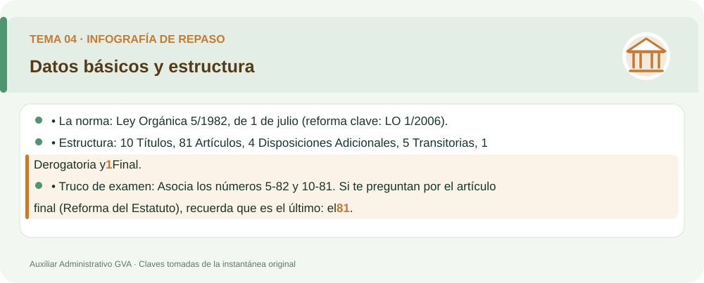

### Instantánea 2: Símbolos y Lengua (Título I)

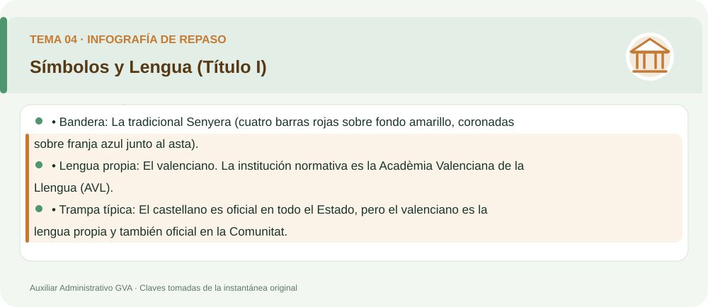

### Instantánea 3: La Generalitat y sus instituciones (Título III)

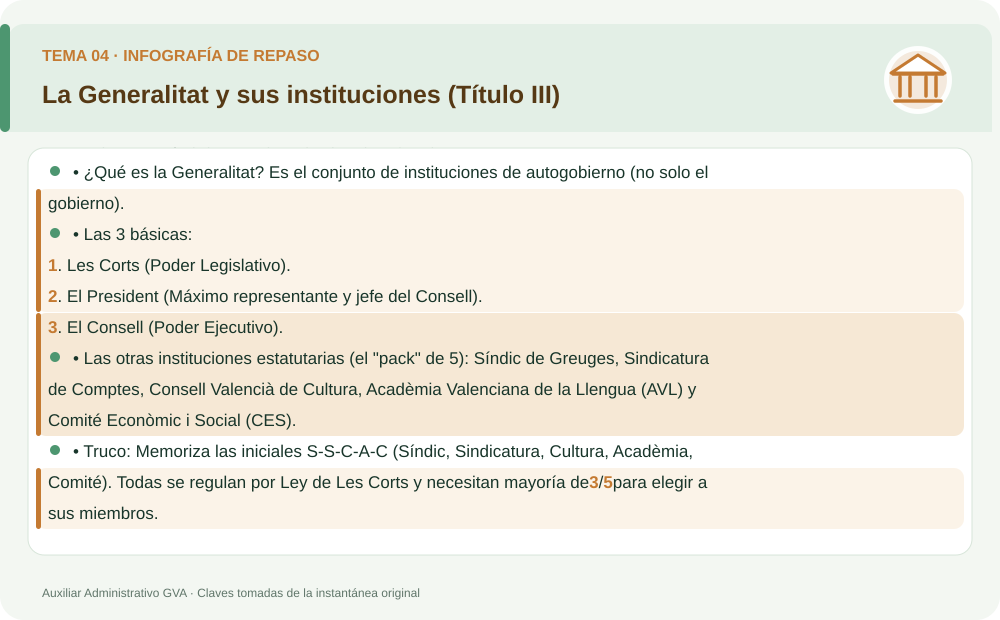

### Instantánea 4: Les Corts Valencianes (Título III, Cap. II)

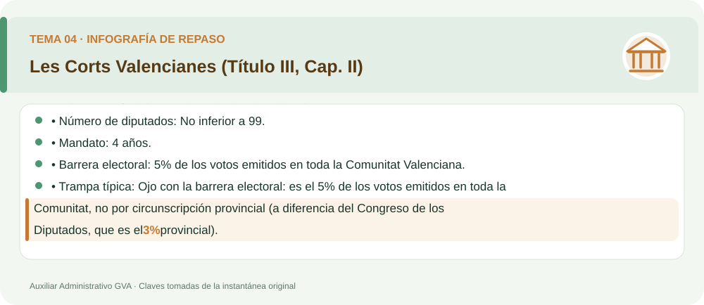

### Instantánea 5: El President y El Consell (Título III, Cap. III y IV)

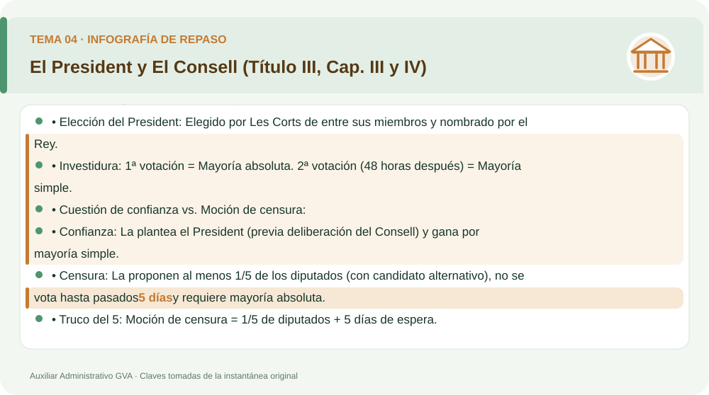

### Instantánea 6: Competencias y Reforma (Títulos IV y X)

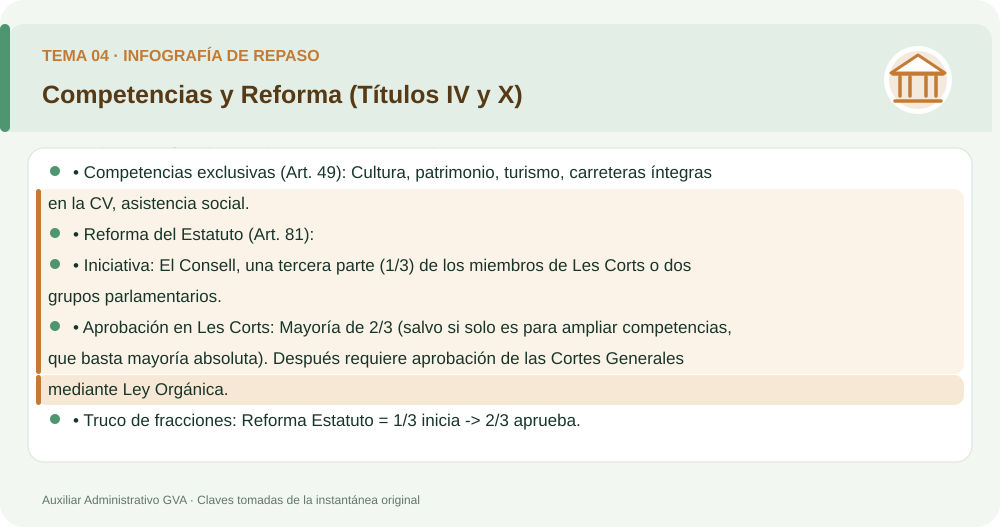

### Instantánea 7: El "Juego de las Mayorías" (Especial C2)

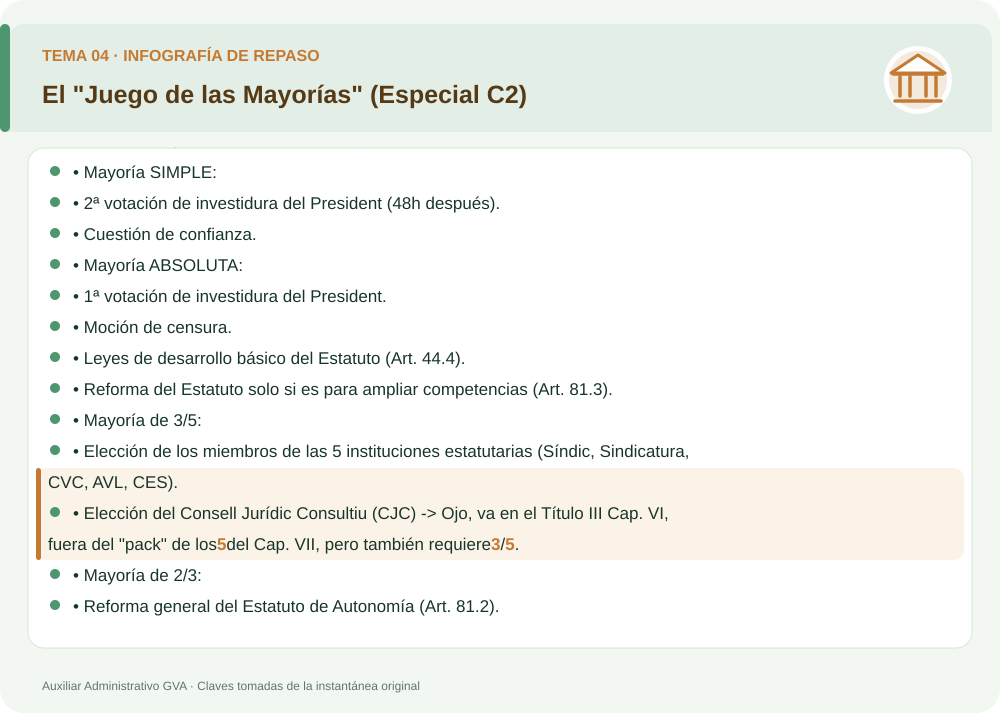

### Instantánea 8: Plazos clave del Título III

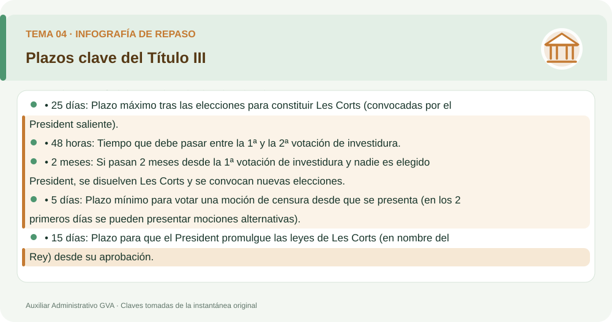

### Instantánea 9: Las leyes de la Generalitat (Art. 44)

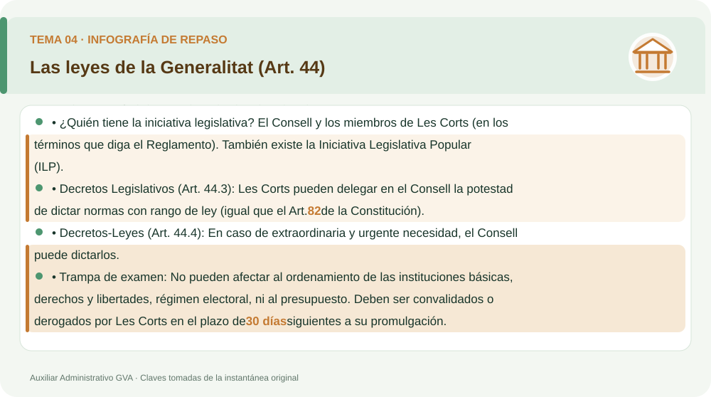

### Instantánea 10: Órganos de control y consulta

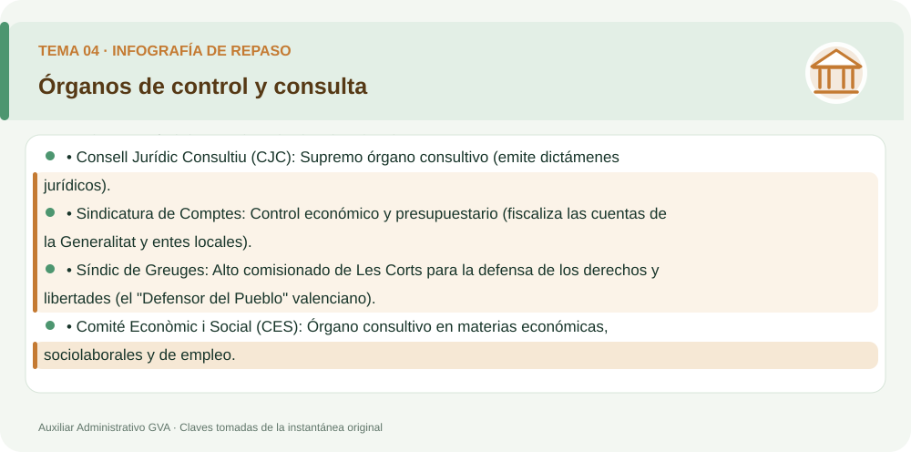

### Instantánea 11: La Hacienda y los Presupuestos (Título VI)

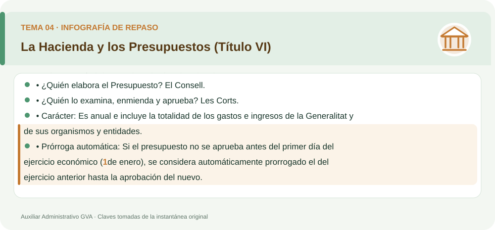
