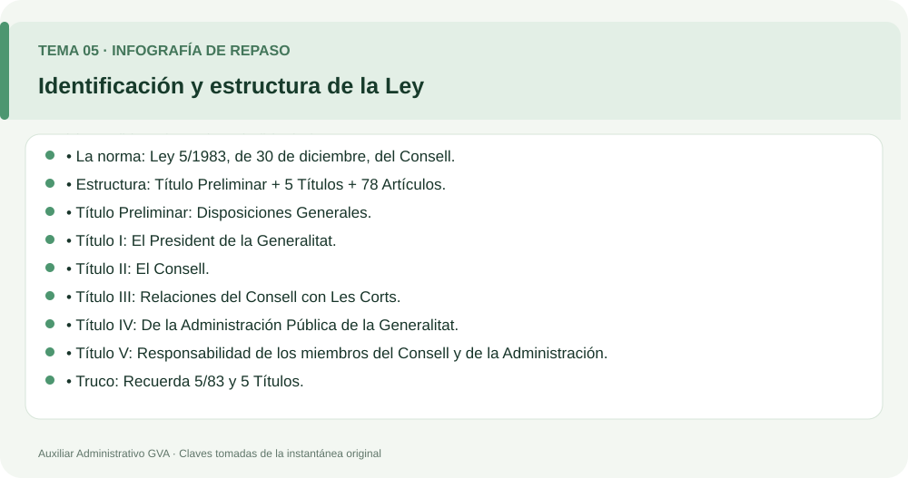
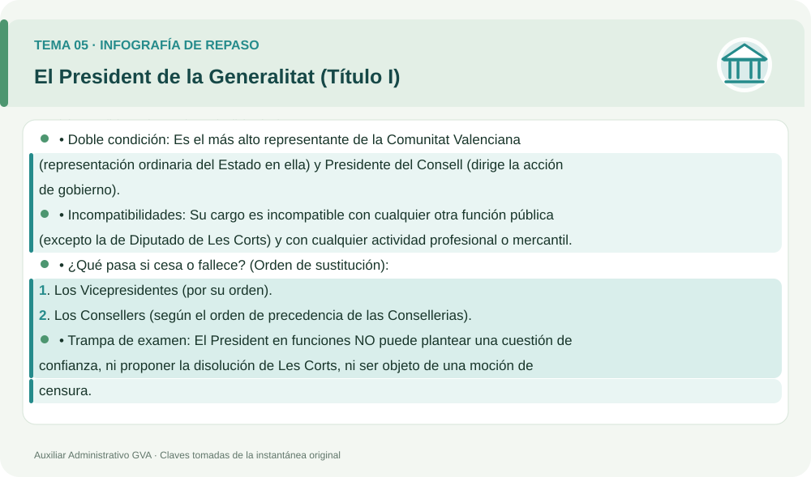
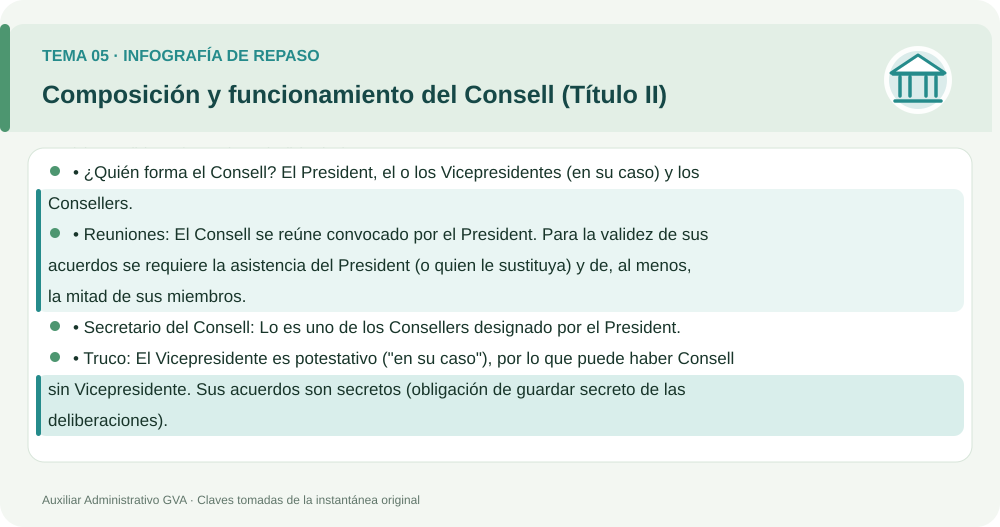

# Tema 05. Ley del Consell (I): President y Consell

> Infografías elaboradas a partir de las instantáneas del documento de estudio. Cada ficha mantiene separadas las normas que aparecen en su contenido.

## Ley del Consell (Ley 5/1983, de 30 de diciembre)

### Instantánea 1: Identificación y estructura de la Ley

### Instantánea 2: El President de la Generalitat (Título I)

### Instantánea 3: Composición y funcionamiento del Consell (Título II)

