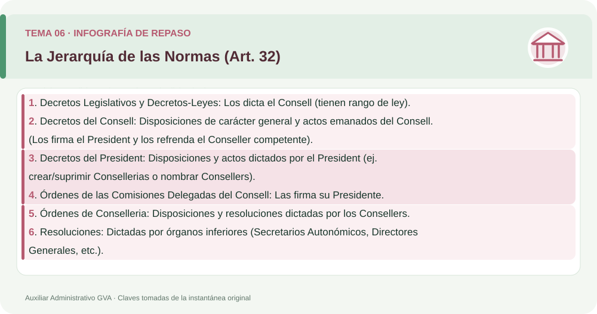
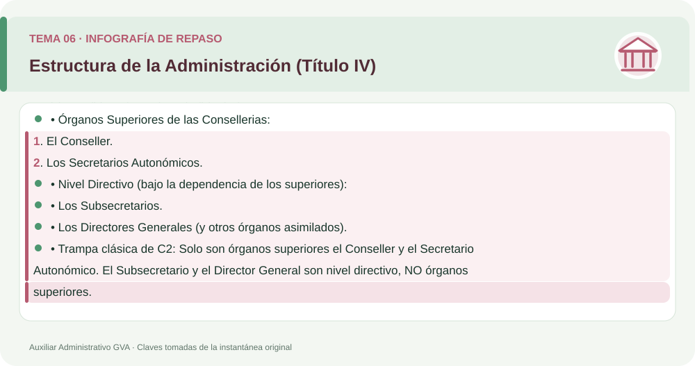
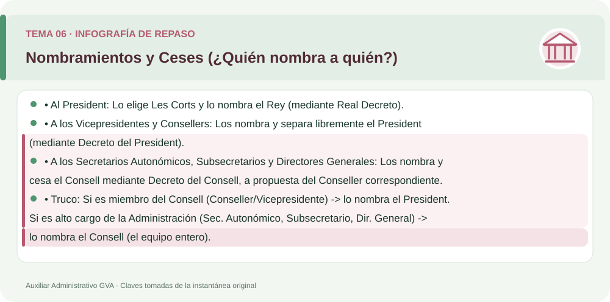

# Tema 06. Ley del Consell (II): relaciones, Administración y responsabilidad

> Infografías elaboradas a partir de las instantáneas del documento de estudio. Cada ficha mantiene separadas las normas que aparecen en su contenido.

## Ley del Consell (Ley 5/1983, de 30 de diciembre)

### Instantánea 4: La Jerarquía de las Normas (Art. 32)

### Instantánea 5: Estructura de la Administración (Título IV)

### Instantánea 6: Nombramientos y Ceses (¿Quién nombra a quién?)

