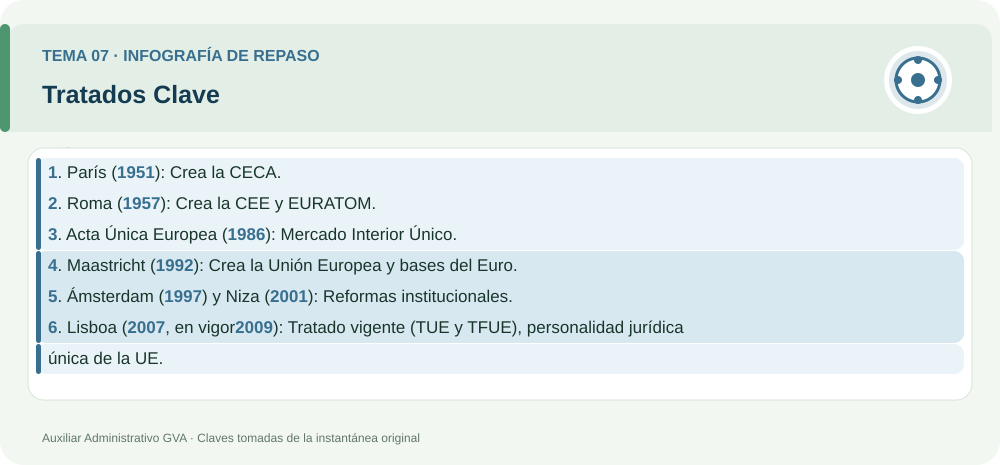
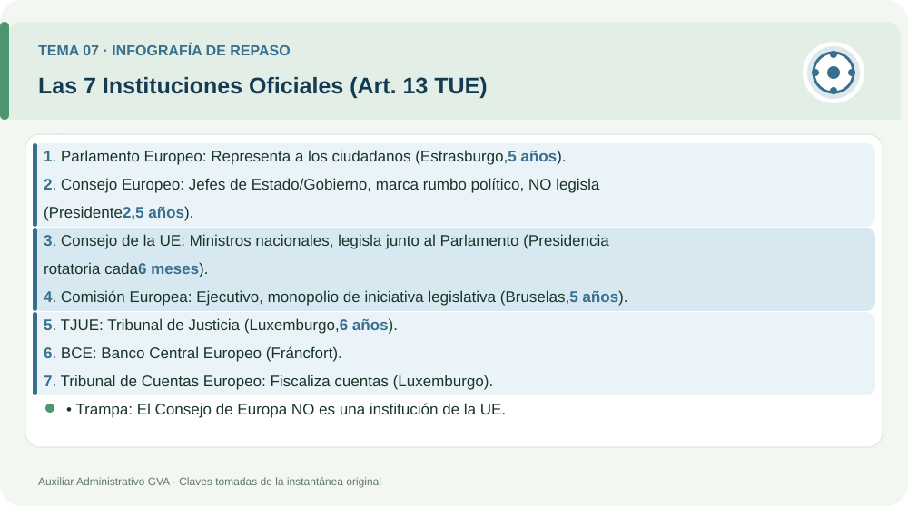
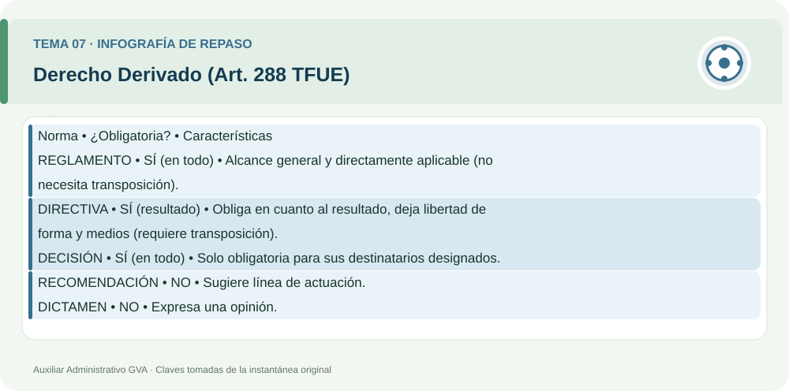
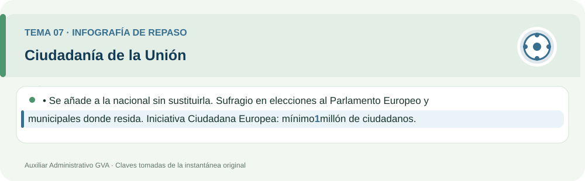

# Tema 07. Unión Europea: TUE, TFUE y actos jurídicos

> Infografías elaboradas a partir de las instantáneas del documento de estudio. Cada ficha mantiene separadas las normas que aparecen en su contenido.

## Unión Europea

### Instantánea 1: Tratados Clave

### Instantánea 2: Las 7 Instituciones Oficiales (Art. 13 TUE)

### Instantánea 3: Derecho Derivado (Art. 288 TFUE)

### Instantánea 4: Procedimiento Legislativo Ordinario

### Instantánea 5: Órganos Consultivos y Defensor del Pueblo

### Instantánea 6: Ciudadanía de la Unión

