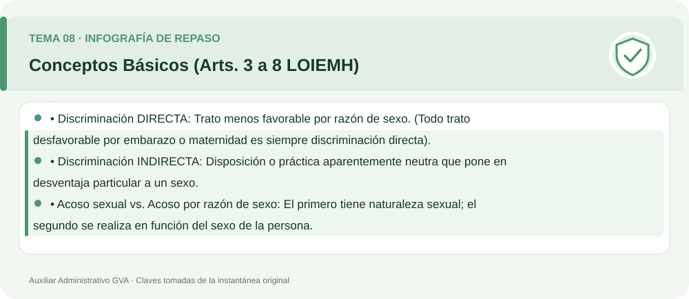
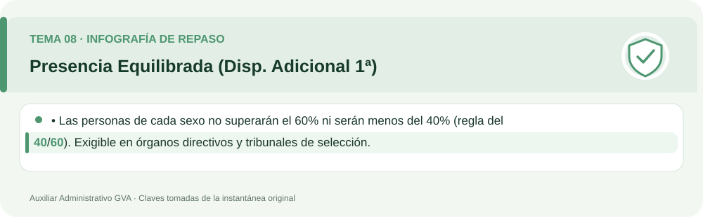
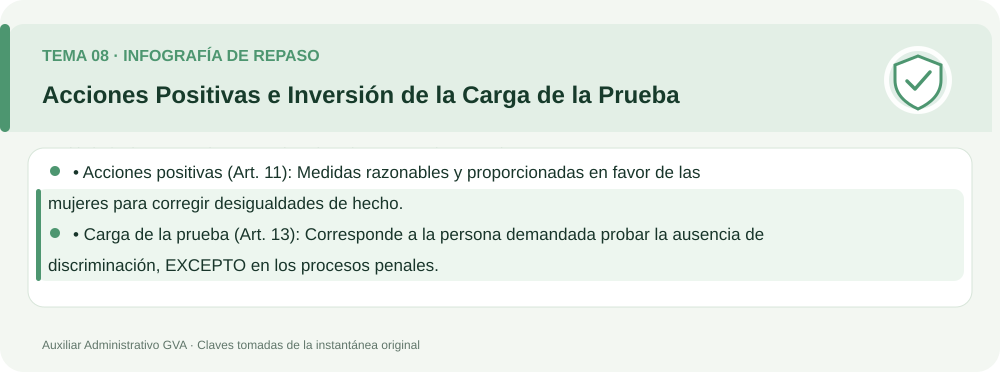
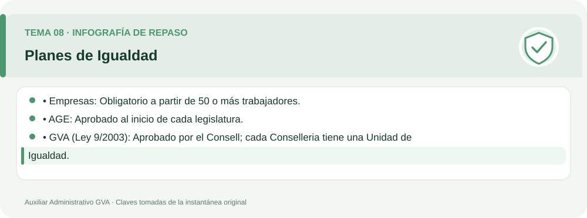
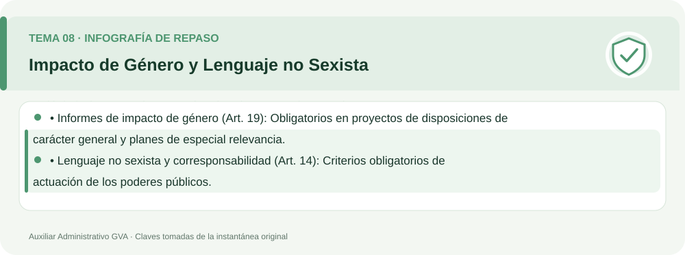
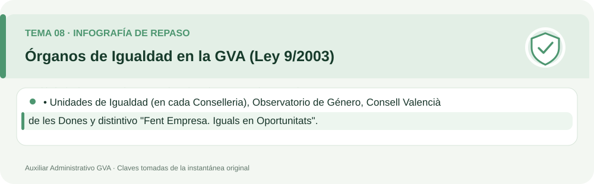
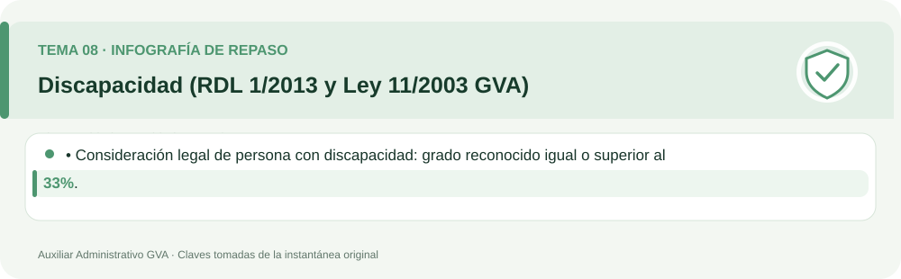
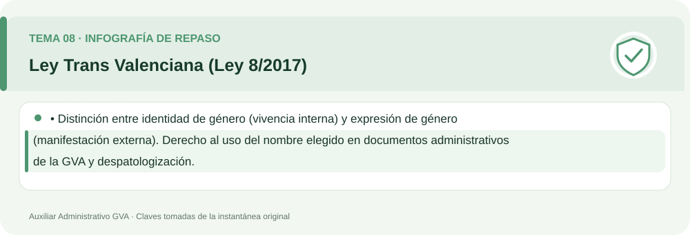
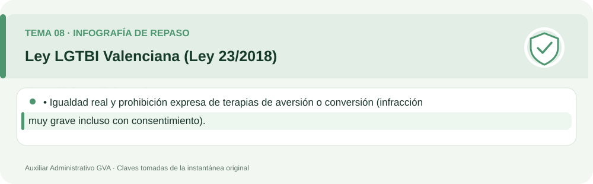
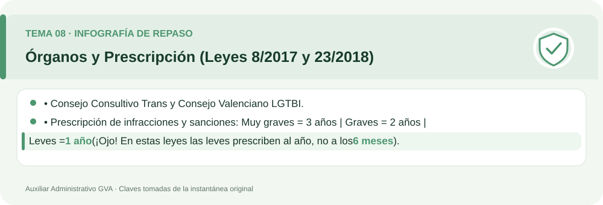

# Tema 08. Igualdad, protección frente a la violencia y derechos LGTBI / trans

> Infografías elaboradas a partir de las instantáneas del documento de estudio. Cada ficha mantiene separadas las normas que aparecen en su contenido.

## Igualdad Efectiva entre Mujeres y Hombres (LO 3/2007 y Ley 9/2003 GVA)

### Instantánea 1: Conceptos Básicos (Arts. 3 a 8 LOIEMH)

### Instantánea 2: Presencia Equilibrada (Disp. Adicional 1ª)

### Instantánea 3: Acciones Positivas e Inversión de la Carga de la Prueba

### Instantánea 4: Planes de Igualdad

### Instantánea 5: Impacto de Género y Lenguaje no Sexista

### Instantánea 6: Órganos de Igualdad en la GVA (Ley 9/2003)

## Material complementario (no incluido expresamente en el programa oficial del tema)

### Instantánea 1: Discapacidad (RDL 1/2013 y Ley 11/2003 GVA)

### Instantánea 2: Cuotas de Reserva en Empleo Público y Privado

### Instantánea 3: Ley Trans Valenciana (Ley 8/2017)

### Instantánea 4: Ley LGTBI Valenciana (Ley 23/2018)

### Instantánea 5: Tipos de Discriminación

### Instantánea 6: Órganos y Prescripción (Leyes 8/2017 y 23/2018)

