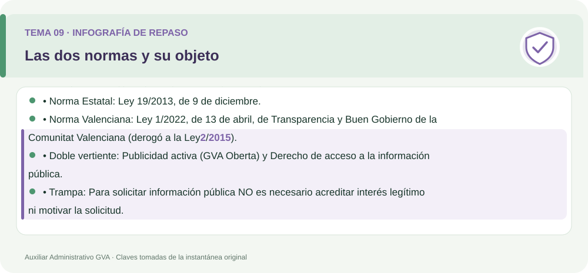
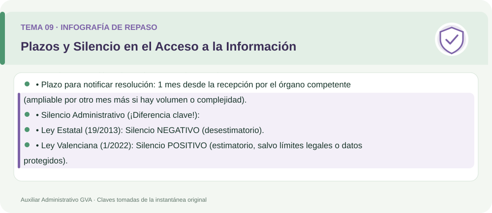
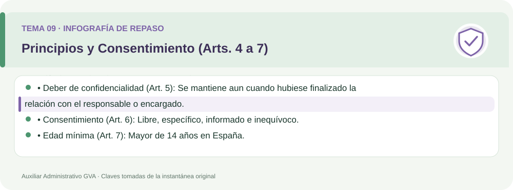
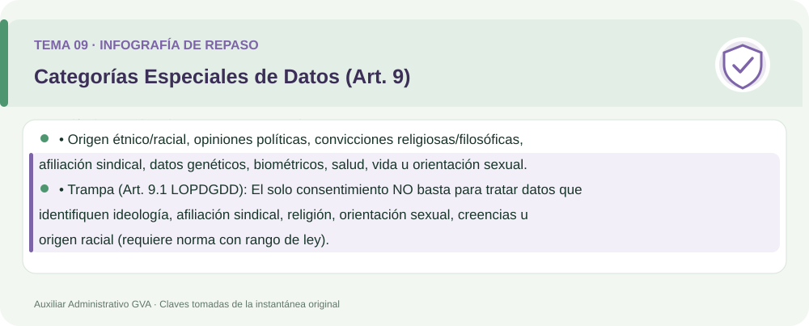
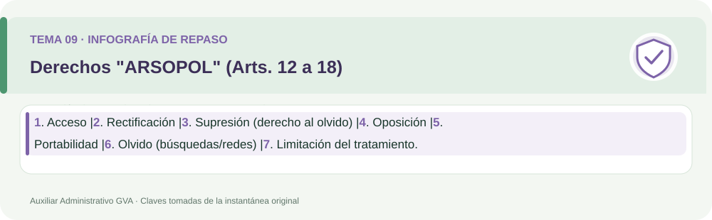
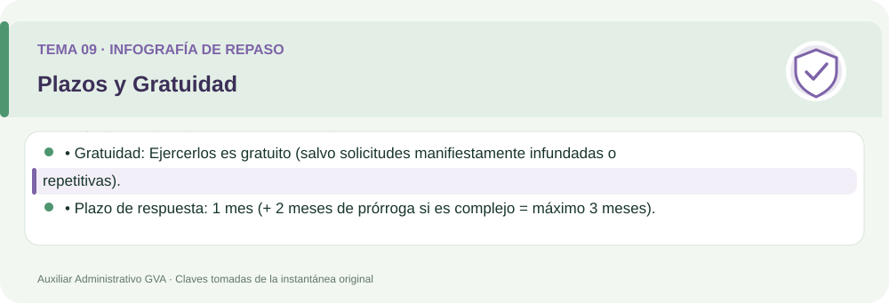
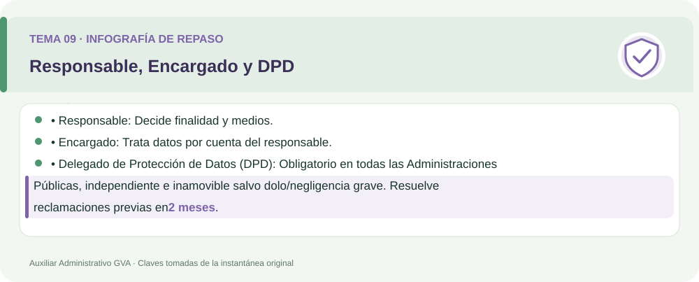
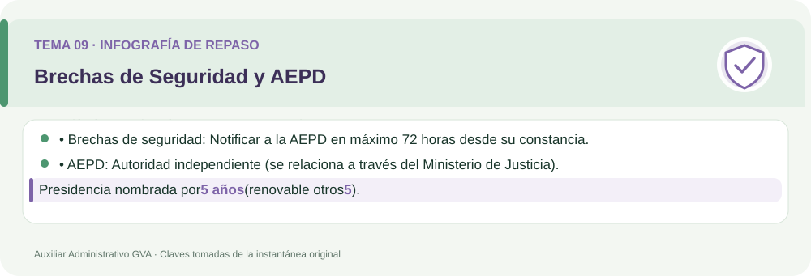

# Tema 09. Transparencia y protección de datos

> Infografías elaboradas a partir de las instantáneas del documento de estudio. Cada ficha mantiene separadas las normas que aparecen en su contenido.

## Transparencia y Buen Gobierno (Ley 19/2013 y Ley 1/2022 GVA)

### Instantánea 1: Las dos normas y su objeto

### Instantánea 2: Plazos y Silencio en el Acceso a la Información

### Instantánea 3: Límites al Derecho de Acceso (Art. 14 Ley 19/2013)

## Protección de Datos (LO 3/2018 LOPDGDD y RGPD)

### Instantánea 1: Principios y Consentimiento (Arts. 4 a 7)

### Instantánea 2: Categorías Especiales de Datos (Art. 9)

### Instantánea 3: Derechos "ARSOPOL" (Arts. 12 a 18)

### Instantánea 4: Plazos y Gratuidad

### Instantánea 5: Responsable, Encargado y DPD

### Instantánea 6: Brechas de Seguridad y AEPD

