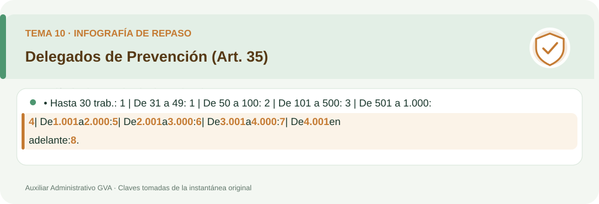

# Tema 10. Prevención de riesgos laborales

> Infografías elaboradas a partir de las instantáneas del documento de estudio. Cada ficha mantiene separadas las normas que aparecen en su contenido.

## Prevención de Riesgos Laborales (Ley 31/1995)

### Instantánea 1: Conceptos Básicos (Art. 4)

### Instantánea 2: Principios de la Acción Preventiva (Art. 15)

### Instantánea 3: Derechos y Obligaciones

### Instantánea 4: Colectivos Especiales

### Instantánea 5: Delegados de Prevención (Art. 35)

### Instantánea 6: Comité de Seguridad y Salud (Arts. 38 y 39)

