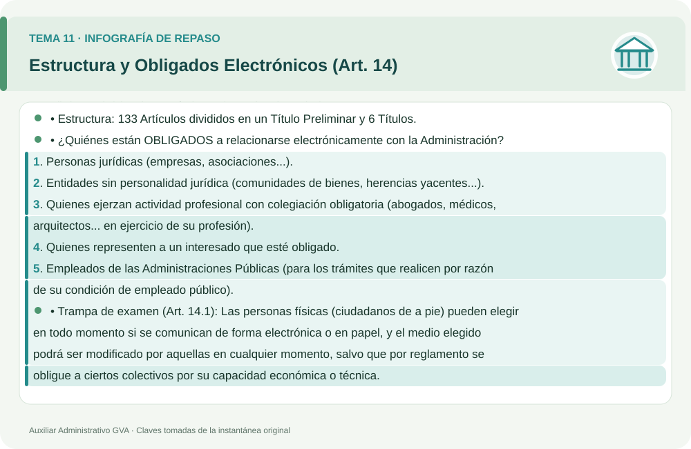
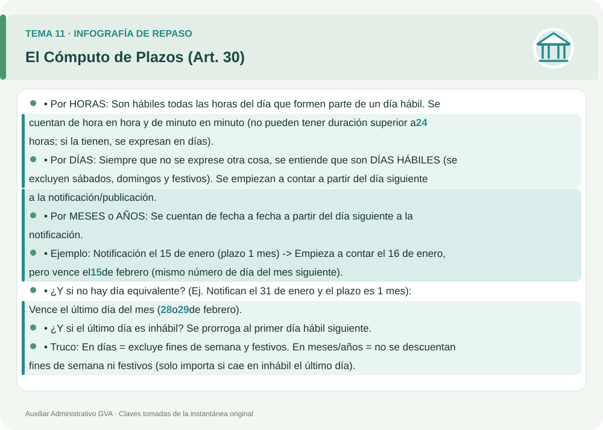
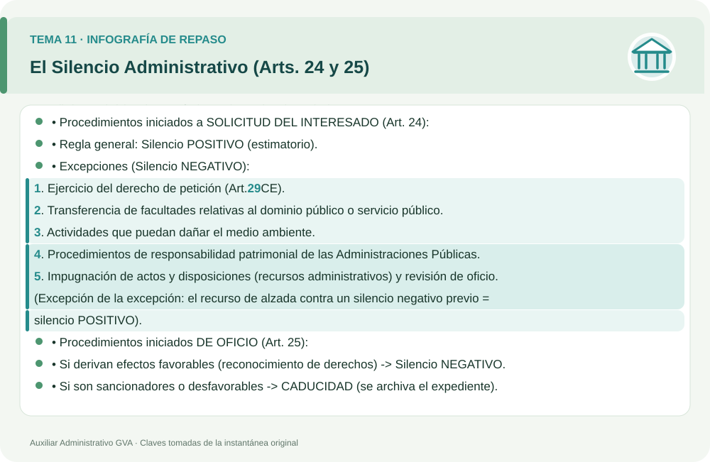
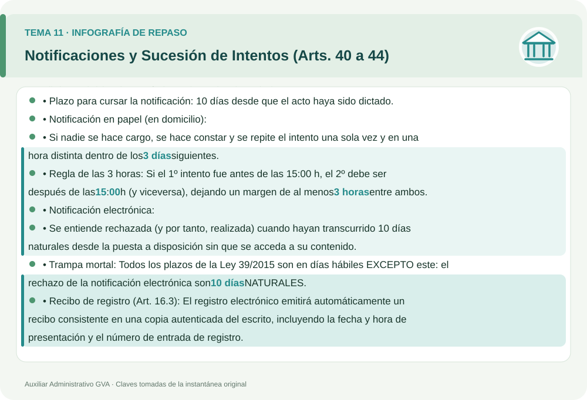
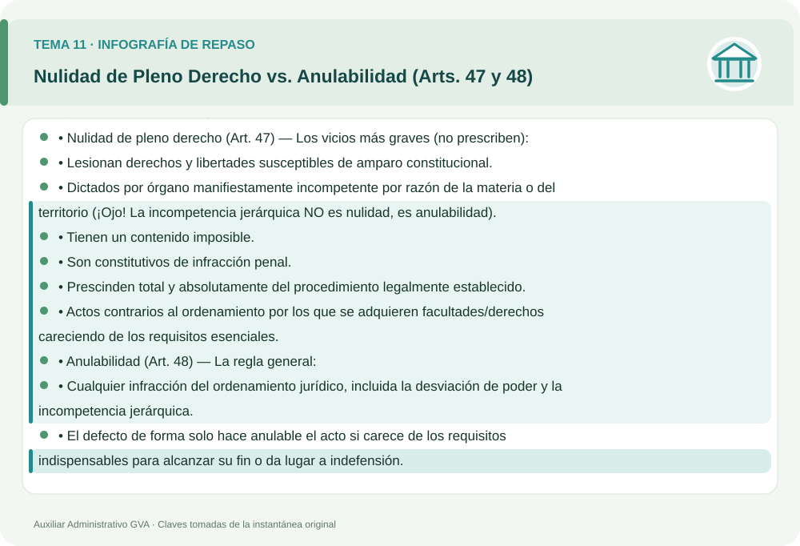

# Tema 11. Ley 39/2015 (I): interesados, actividad y actos administrativos

> Infografías elaboradas a partir de las instantáneas del documento de estudio. Cada ficha mantiene separadas las normas que aparecen en su contenido.

## Procedimiento Administrativo Común (Ley 39/2015, de 1 de octubre)

### Instantánea 1: Estructura y Obligados Electrónicos (Art. 14)

### Instantánea 2: El Cómputo de Plazos (Art. 30)

### Instantánea 3: El Silencio Administrativo (Arts. 24 y 25)

### Instantánea 4: Notificaciones y Sucesión de Intentos (Arts. 40 a 44)

### Instantánea 5: Nulidad de Pleno Derecho vs. Anulabilidad (Arts. 47 y 48)

