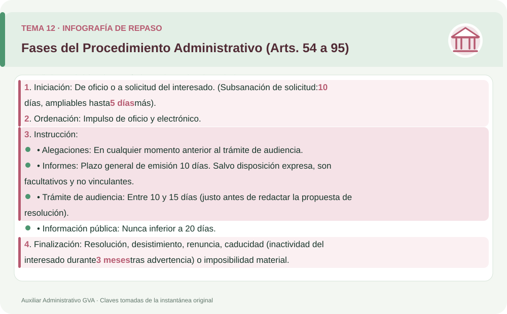
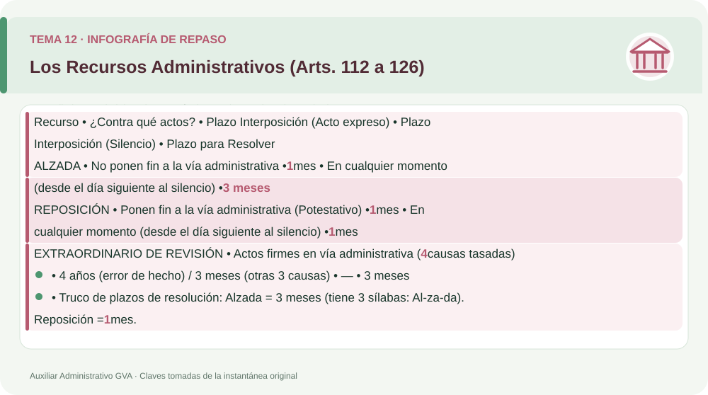

# Tema 12. Ley 39/2015 (II): procedimiento y recursos administrativos

> Infografías elaboradas a partir de las instantáneas del documento de estudio. Cada ficha mantiene separadas las normas que aparecen en su contenido.

## Procedimiento Administrativo Común (Ley 39/2015, de 1 de octubre)

### Instantánea 6: Fases del Procedimiento Administrativo (Arts. 54 a 95)

### Instantánea 7: Los Recursos Administrativos (Arts. 112 a 126)

