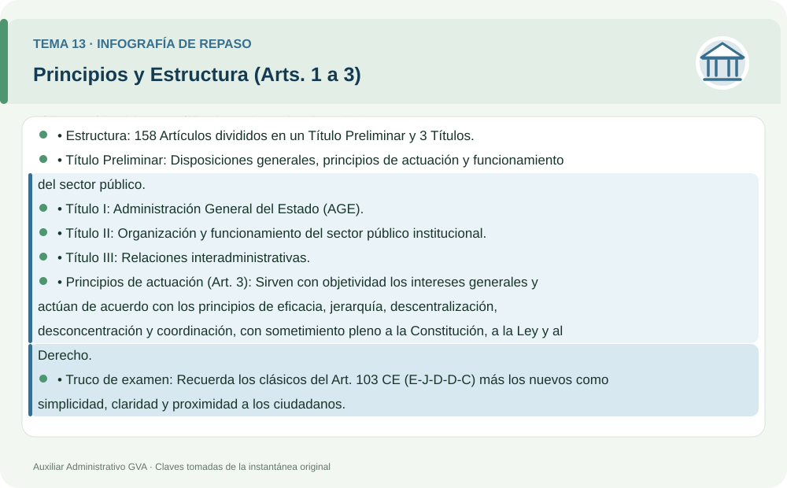
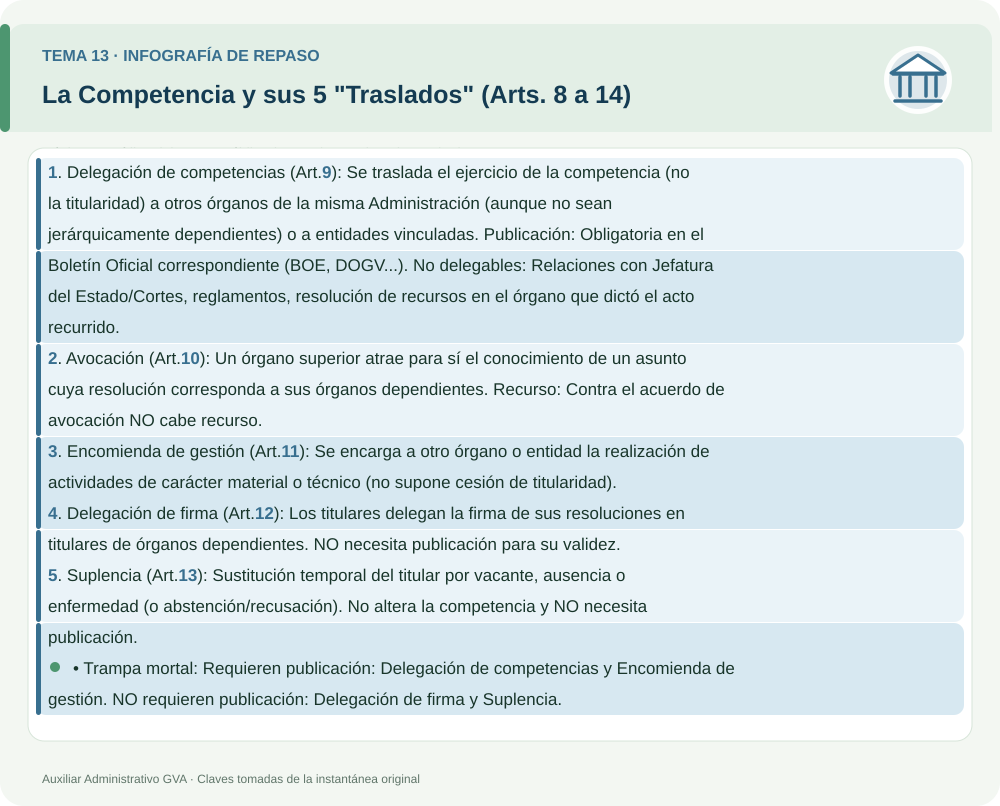
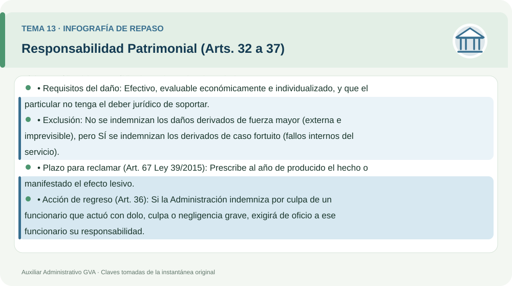

# Tema 13. Ley 40/2015: régimen jurídico del sector público

> Infografías elaboradas a partir de las instantáneas del documento de estudio. Cada ficha mantiene separadas las normas que aparecen en su contenido.

## Régimen Jurídico del Sector Público (Ley 40/2015, de 1 de octubre)

### Instantánea 1: Principios y Estructura (Arts. 1 a 3)

### Instantánea 2: La Competencia y sus 5 "Traslados" (Arts. 8 a 14)

### Instantánea 3: Órganos Colegiados (Arts. 15 a 18)

### Instantánea 4: Abstención y Recusación (Arts. 23 y 24)

### Instantánea 5: Potestad Sancionadora (Arts. 25 a 31)

### Instantánea 6: Responsabilidad Patrimonial (Arts. 32 a 37)

