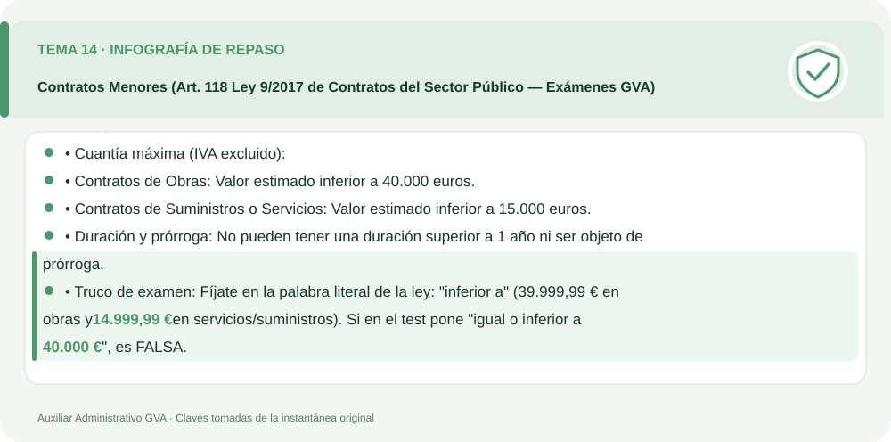

# Tema 14. Ley 9/2017: contratos del sector público

> Infografías elaboradas a partir de las instantáneas del documento de estudio. Cada ficha mantiene separadas las normas que aparecen en su contenido.

## Hacienda Pública, Presupuestos y Contratación (Ley 1/2015 y Ley 9/2017)

### Instantánea 8: Contratos Menores (Art. 118 Ley 9/2017 de Contratos del Sector Público — Exámenes GVA)

