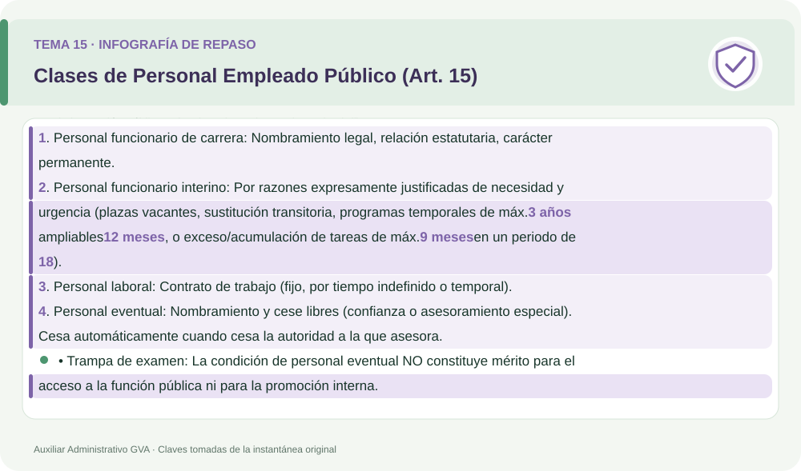
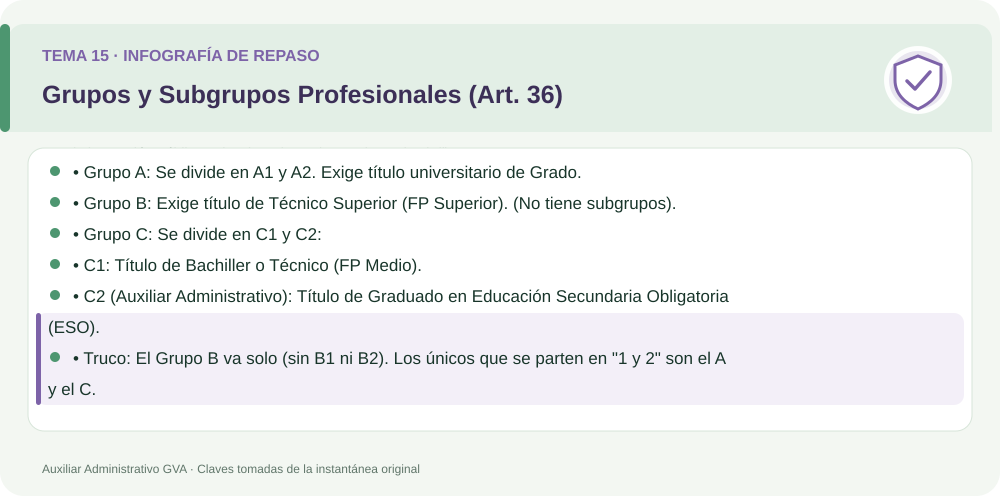
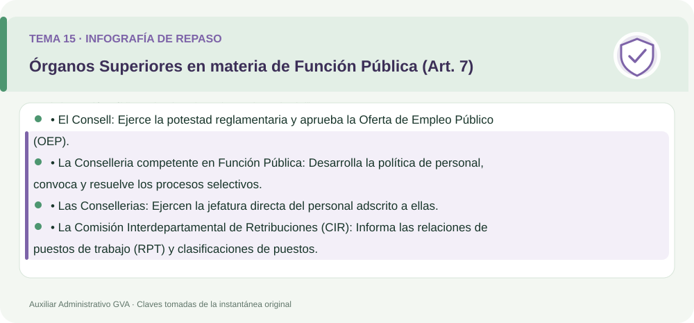
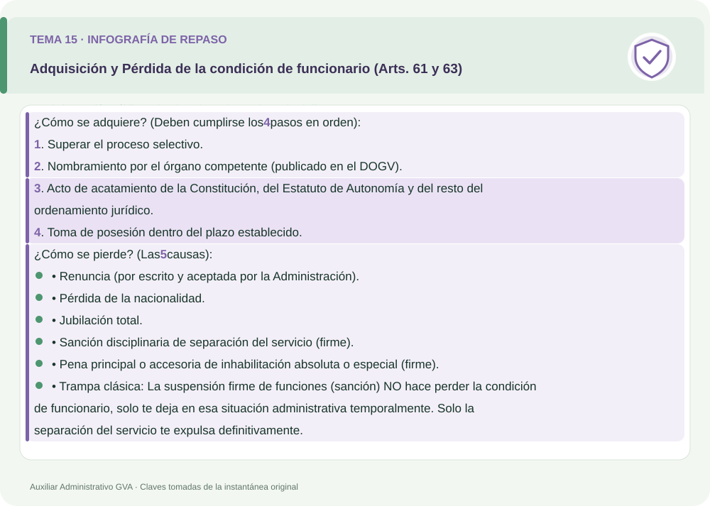
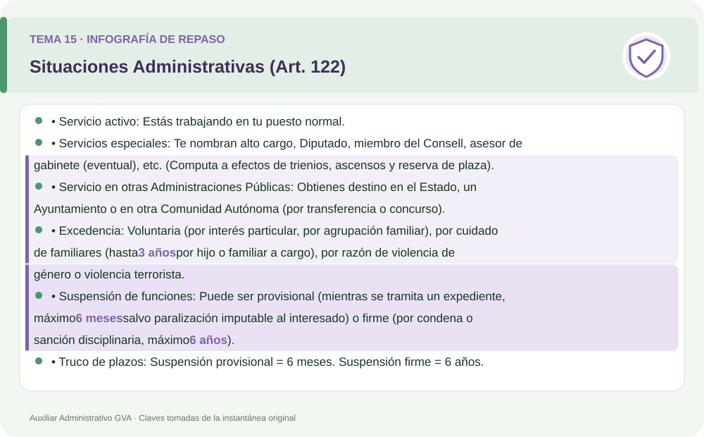
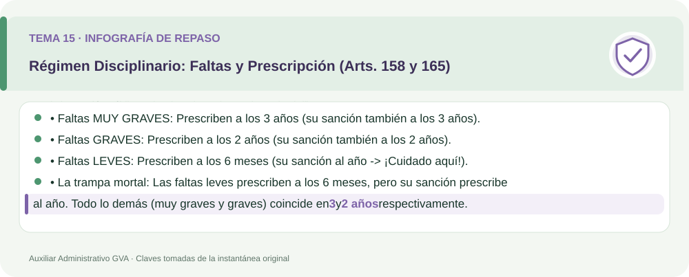
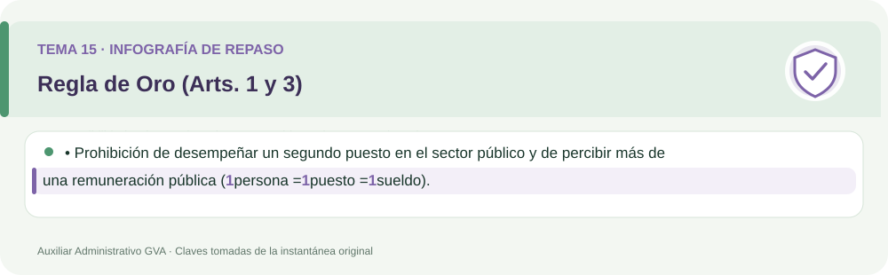
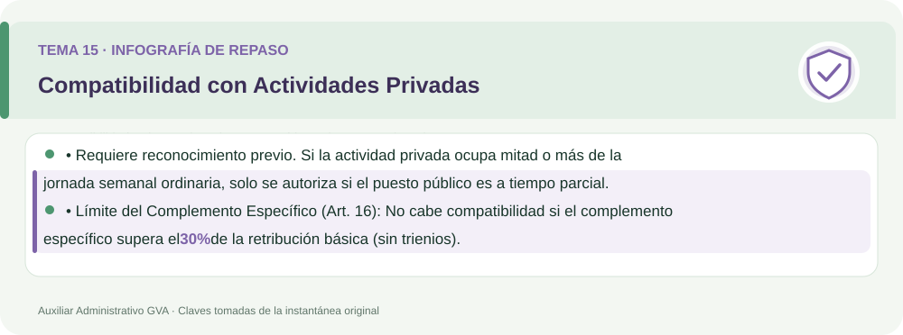
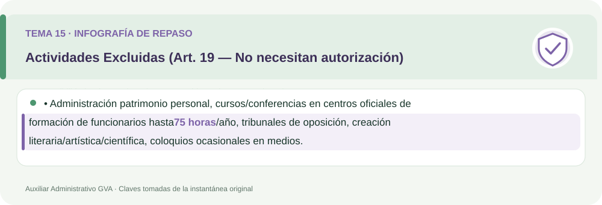
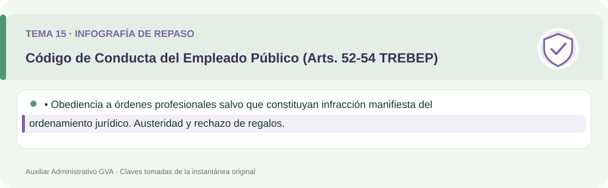

# Tema 15. Función Pública Valenciana: personal, relación de servicio e incompatibilidades

> Infografías elaboradas a partir de las instantáneas del documento de estudio. Cada ficha mantiene separadas las normas que aparecen en su contenido.

## Ley de la Función Pública Valenciana (Ley 4/2021, de 16 de abril)

### Instantánea 1: Clases de Personal Empleado Público (Art. 15)

### Instantánea 2: Grupos y Subgrupos Profesionales (Art. 36)

### Instantánea 3: Órganos Superiores en materia de Función Pública (Art. 7)

### Instantánea 4: Adquisición y Pérdida de la condición de funcionario (Arts. 61 y 63)

### Instantánea 5: Situaciones Administrativas (Art. 122)

### Instantánea 6: Régimen Disciplinario: Faltas y Prescripción (Arts. 158 y 165)

## Material complementario (no incluido expresamente en el programa oficial del tema)

### Instantánea 1: Regla de Oro (Arts. 1 y 3)

### Instantánea 2: Excepciones en el Sector Público

### Instantánea 3: Compatibilidad con Actividades Privadas

### Instantánea 4: Actividades Excluidas (Art. 19 — No necesitan autorización)

### Instantánea 5: Código de Buen Gobierno GVA (Decreto 56/2016)

### Instantánea 6: Código de Conducta del Empleado Público (Arts. 52-54 TREBEP)

