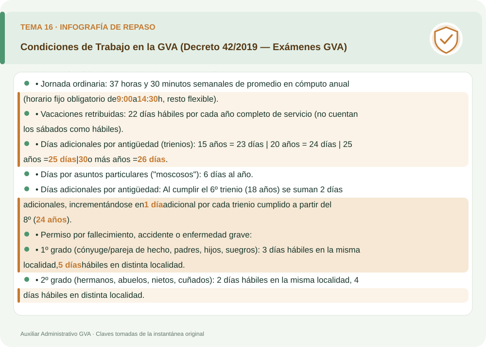

# Tema 16. Decreto 42/2019: condiciones de trabajo del personal funcionario GVA

> Infografías elaboradas a partir de las instantáneas del documento de estudio. Cada ficha mantiene separadas las normas que aparecen en su contenido.

## Ley de la Función Pública Valenciana (Ley 4/2021, de 16 de abril)

### Instantánea 7: Condiciones de Trabajo en la GVA (Decreto 42/2019 — Exámenes GVA)

