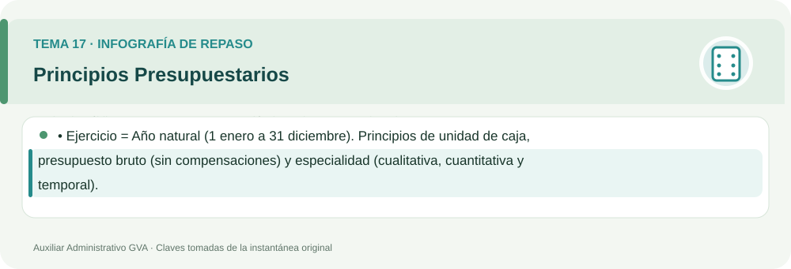
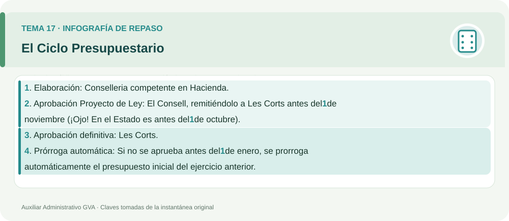
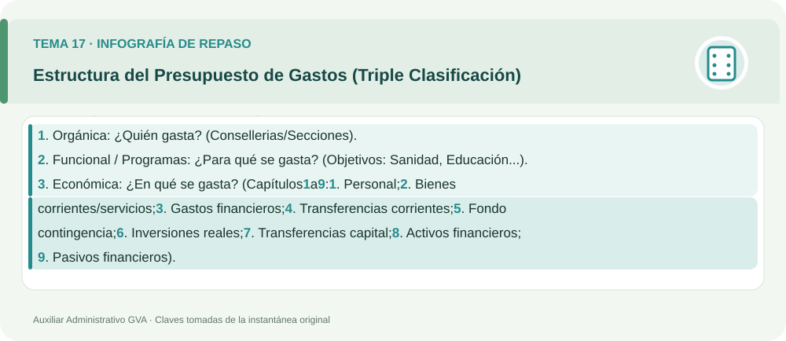
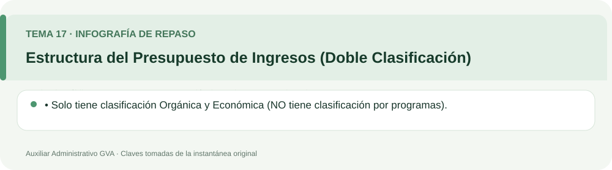
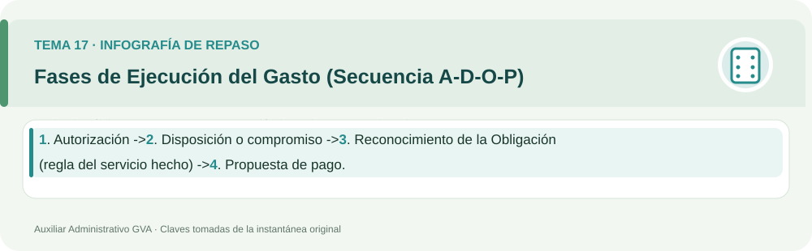
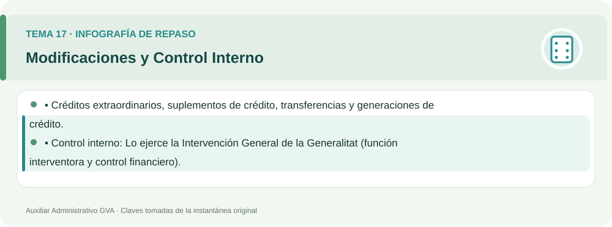

# Tema 17. Presupuestos GVA (I): principios, estructura y modificaciones

> Infografías elaboradas a partir de las instantáneas del documento de estudio. Cada ficha mantiene separadas las normas que aparecen en su contenido.

## Hacienda Pública, Presupuestos y Contratación (Ley 1/2015 y Ley 9/2017)

### Instantánea 1: Principios Presupuestarios

### Instantánea 2: El Ciclo Presupuestario

### Instantánea 3: Estructura del Presupuesto de Gastos (Triple Clasificación)

### Instantánea 4: Estructura del Presupuesto de Ingresos (Doble Clasificación)

### Instantánea 5: Fases de Ejecución del Gasto (Secuencia A-D-O-P)

### Instantánea 6: Modificaciones y Control Interno

