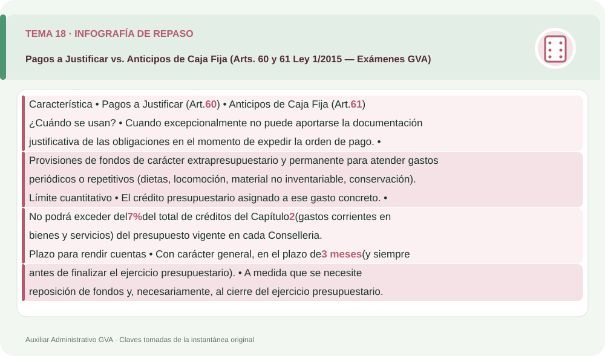

# Tema 18. Presupuestos GVA (II): ejecución, pagos y anticipos de caja fija

> Infografías elaboradas a partir de las instantáneas del documento de estudio. Cada ficha mantiene separadas las normas que aparecen en su contenido.

## Hacienda Pública, Presupuestos y Contratación (Ley 1/2015 y Ley 9/2017)

### Instantánea 7: Pagos a Justificar vs. Anticipos de Caja Fija (Arts. 60 y 61 Ley 1/2015 — Exámenes GVA)

