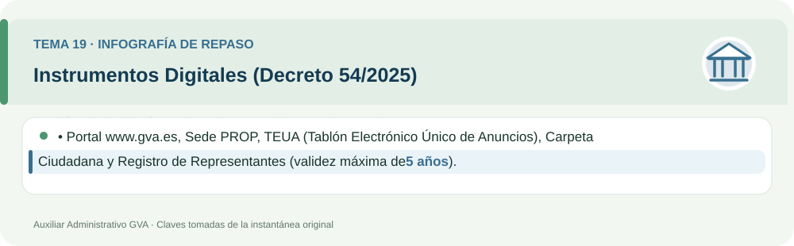

# Tema 19. Administración electrónica en la Comunitat Valenciana

> Infografías elaboradas a partir de las instantáneas del documento de estudio. Cada ficha mantiene separadas las normas que aparecen en su contenido.

## Atención a la Ciudadanía y Registro (Decretos 30/2025 y 54/2025 GVA)

### Instantánea 6: Instrumentos Digitales (Decreto 54/2025)

