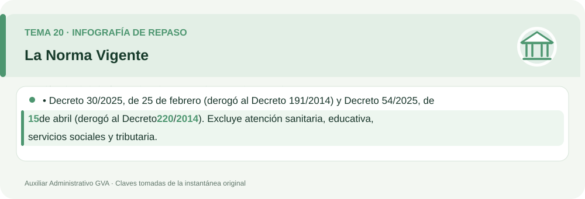
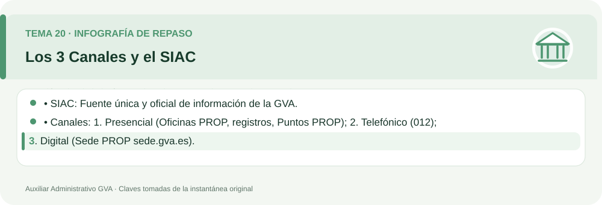
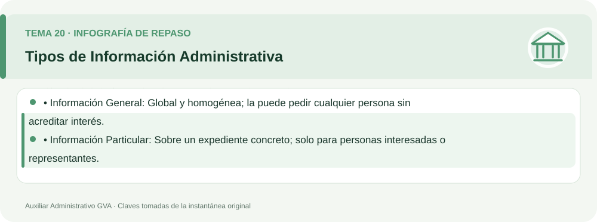
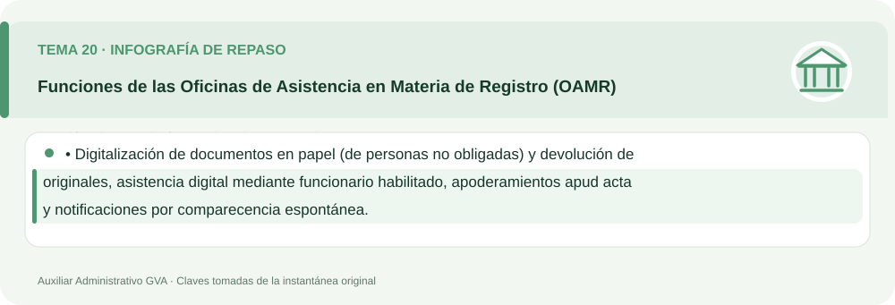
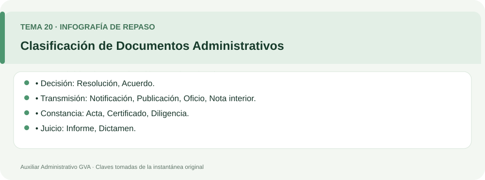
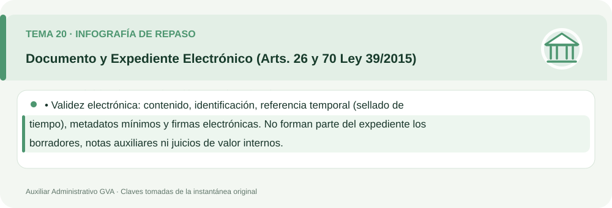
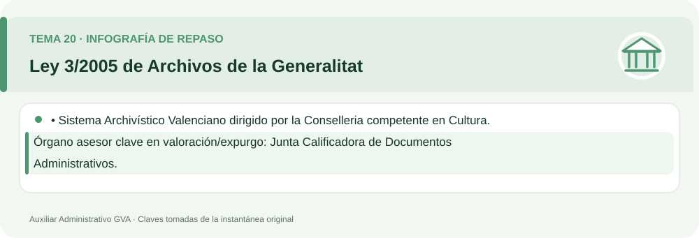
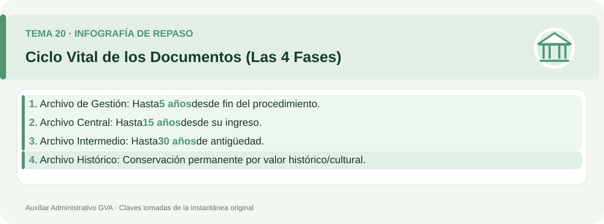
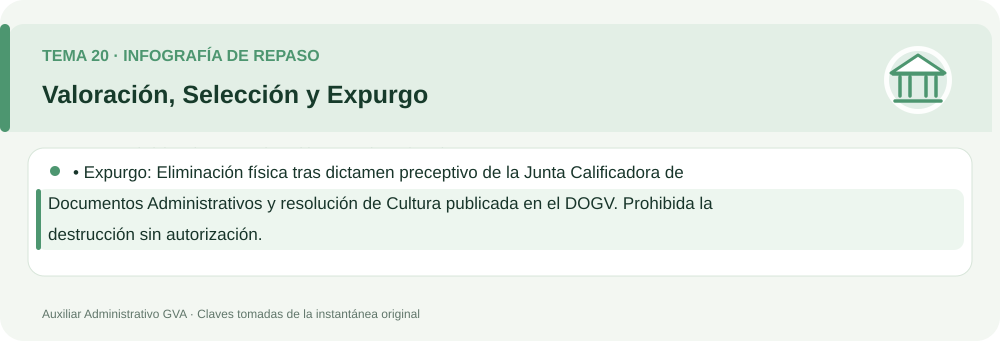
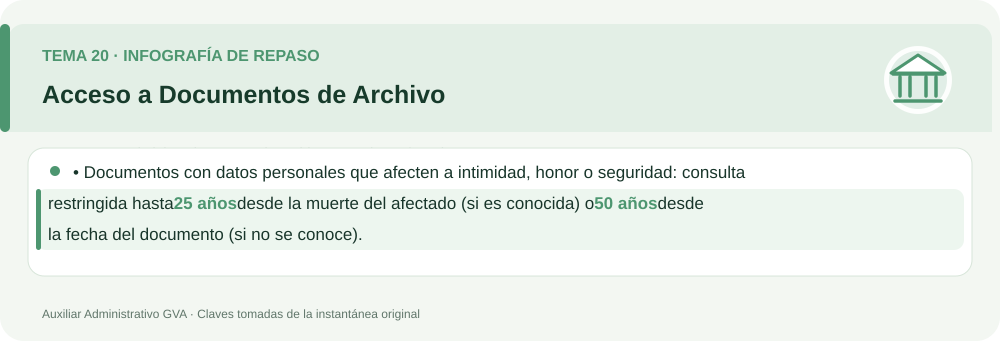

# Tema 20. Atención a la ciudadanía, registro y documentos administrativos

> Infografías elaboradas a partir de las instantáneas del documento de estudio. Cada ficha mantiene separadas las normas que aparecen en su contenido.

## Atención a la Ciudadanía y Registro (Decretos 30/2025 y 54/2025 GVA)

### Instantánea 1: La Norma Vigente

### Instantánea 2: Principios y Usos Lingüísticos

### Instantánea 3: Los 3 Canales y el SIAC

### Instantánea 4: Tipos de Información Administrativa

### Instantánea 5: Funciones de las Oficinas de Asistencia en Materia de Registro (OAMR)

## Material complementario (no incluido expresamente en el programa oficial del tema)

### Instantánea 1: Clasificación de Documentos Administrativos

### Instantánea 2: Documento y Expediente Electrónico (Arts. 26 y 70 Ley 39/2015)

### Instantánea 3: Ley 3/2005 de Archivos de la Generalitat

### Instantánea 4: Ciclo Vital de los Documentos (Las 4 Fases)

### Instantánea 5: Valoración, Selección y Expurgo

### Instantánea 6: Acceso a Documentos de Archivo

