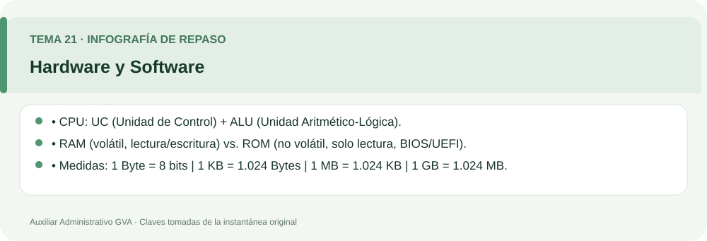
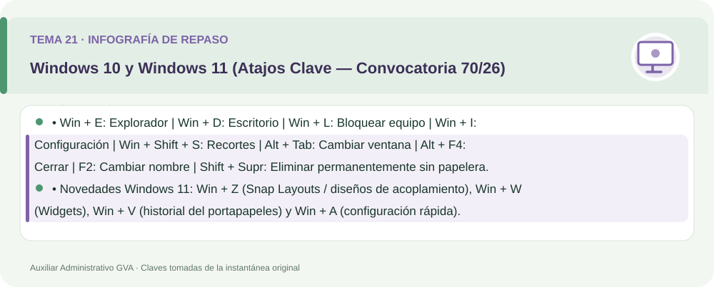

# Tema 21. Informática: hardware, software y Windows

> Infografías elaboradas a partir de las instantáneas del documento de estudio. Cada ficha mantiene separadas las normas que aparecen en su contenido.

## Informática, Ofimática 365 y Seguridad en la GVA (Orden 9/2026 y Orden 19/2013)

### Instantánea 1: Hardware y Software

### Instantánea 2: Windows 10 y Windows 11 (Atajos Clave — Convocatoria 70/26)

