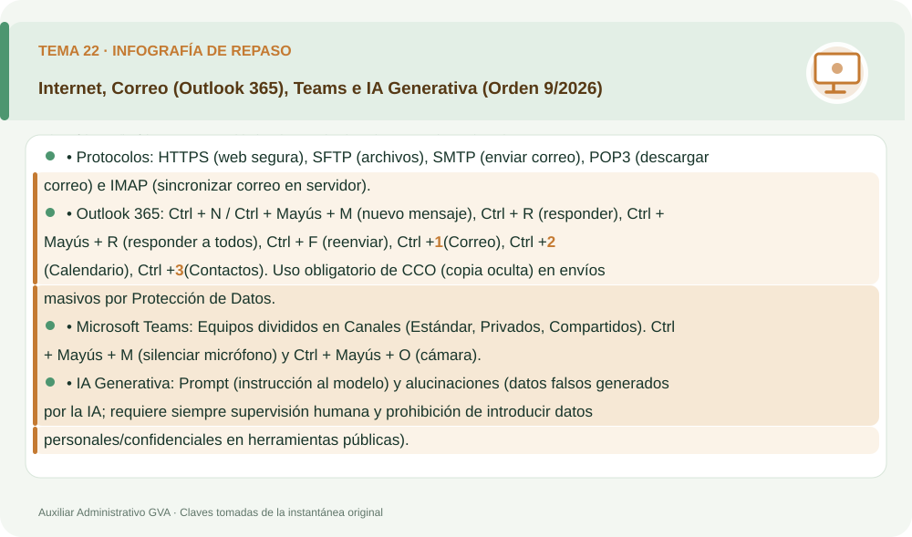

# Tema 22. Comunicación y colaboración: Outlook, Teams e Internet

> Infografías elaboradas a partir de las instantáneas del documento de estudio. Cada ficha mantiene separadas las normas que aparecen en su contenido.

## Informática, Ofimática 365 y Seguridad en la GVA (Orden 9/2026 y Orden 19/2013)

### Instantánea 6: Internet, Correo (Outlook 365), Teams e IA Generativa (Orden 9/2026)

