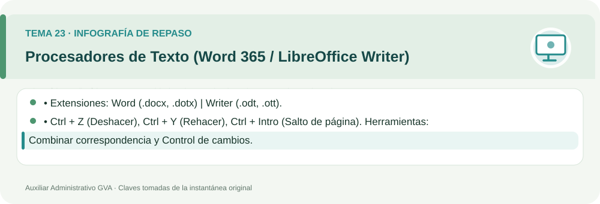
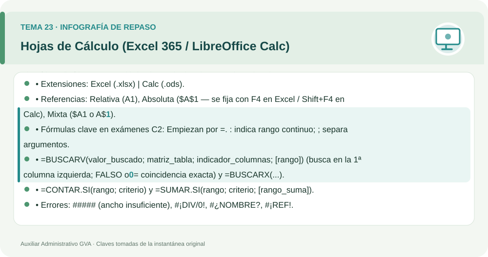
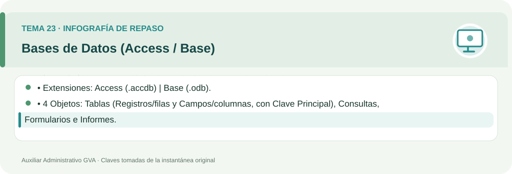

# Tema 23. Creación de contenidos digitales: Word, Excel y bases de datos

> Infografías elaboradas a partir de las instantáneas del documento de estudio. Cada ficha mantiene separadas las normas que aparecen en su contenido.

## Informática, Ofimática 365 y Seguridad en la GVA (Orden 9/2026 y Orden 19/2013)

### Instantánea 3: Procesadores de Texto (Word 365 / LibreOffice Writer)

### Instantánea 4: Hojas de Cálculo (Excel 365 / LibreOffice Calc)

### Instantánea 5: Bases de Datos (Access / Base)

