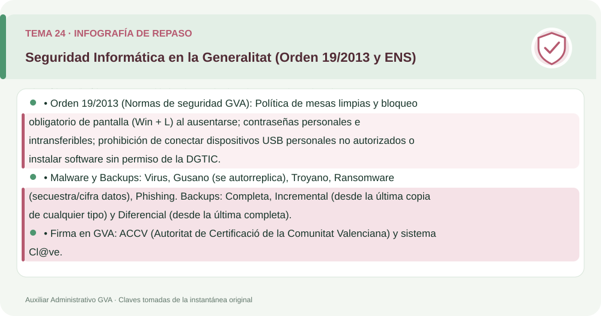

# Tema 24. Seguridad digital en la Generalitat

> Infografías elaboradas a partir de las instantáneas del documento de estudio. Cada ficha mantiene separadas las normas que aparecen en su contenido.

## Informática, Ofimática 365 y Seguridad en la GVA (Orden 9/2026 y Orden 19/2013)

### Instantánea 7: Seguridad Informática en la Generalitat (Orden 19/2013 y ENS)

